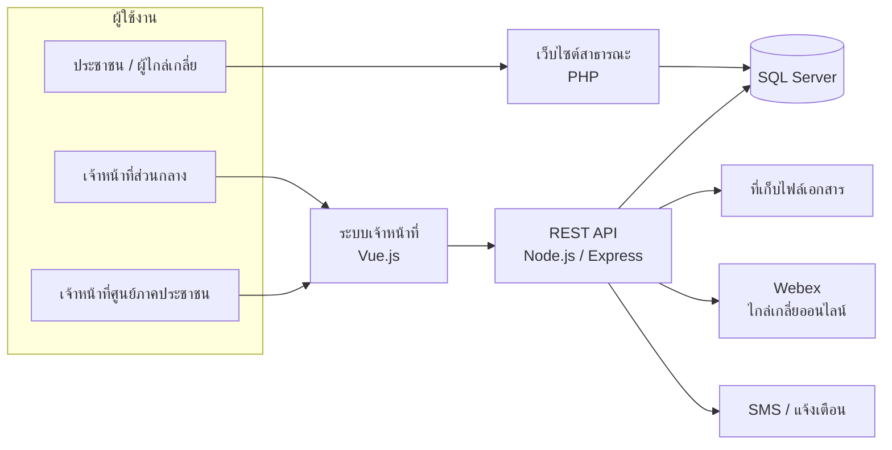
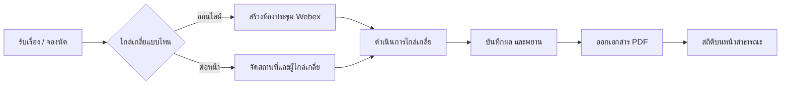
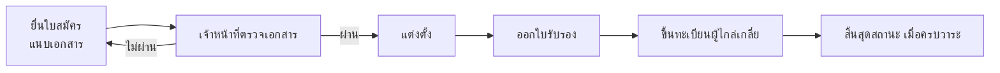
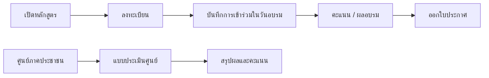

# Civil Mediation Management Platform (Case Study)

ระบบเว็บสำหรับหน่วยงานภาครัฐ ใช้บริหารงานไกล่เกลี่ยข้อพิพาททั่วประเทศ ครอบคลุมตั้งแต่การรับเรื่อง การจัดการผู้ไกล่เกลี่ย ศูนย์ไกล่เกลี่ยภาคประชาชน ไปจนถึงการอบรมและการประเมินผล

> **หมายเหตุ:** เป็นระบบใช้งานจริงของหน่วยงานรัฐ จึงไม่เปิดเผยชื่อหน่วยงาน โค้ด และข้อมูล repository นี้เป็นเอกสารอธิบายงานที่ผมรับผิดชอบเท่านั้น ยินดีเล่าเชิงเทคนิคเพิ่มในการสัมภาษณ์

## ขนาดของระบบ
- ใช้งานทั่วประเทศ หน้าสาธารณะของระบบแสดงสถิติเรื่องไกล่เกลี่ยสำเร็จหลักพันเรื่อง และผู้ไกล่เกลี่ยหลักพันคน (ตามที่ระบบเผยแพร่)
- ฐานข้อมูลกว่า 60 ตาราง ครอบคลุมเรื่องไกล่เกลี่ย ผู้ไกล่เกลี่ย ศูนย์ภาคประชาชน การอบรมและการประเมินผล
- มีหลายบทบาทผู้ใช้ (เจ้าหน้าที่ส่วนกลาง เจ้าหน้าที่ศูนย์ ผู้ไกล่เกลี่ย ประชาชน) พร้อมสิทธิ์รายเมนู

## บทบาทของผม
เป็นโปรเจกต์ทีมที่ทำต่อเนื่องหลายปี (พ.ศ. 2565–2569) มีผู้ร่วมพัฒนาหลายรุ่น ผมเป็นหนึ่งในผู้พัฒนาหลักฝั่ง frontend และเป็นผู้ดูแลระบบหลักในช่วงหลัง (commit มากที่สุดใน repository ฝั่ง frontend รุ่นล่าสุด: ประมาณ 84 จาก 98 ครั้ง) ปัจจุบันระบบส่งมอบให้ทีมของบริษัทอื่นรับช่วงดูแลต่อแล้ว

- พัฒนาหน้าจอฝั่งเจ้าหน้าที่ด้วย Vue.js เป็นหลัก (เรื่องไกล่เกลี่ย, อบรม, ไกล่เกลี่ยออนไลน์) ตั้งแต่ พ.ศ. 2565 (2022)
- ย้ายส่วนเจ้าหน้าที่จาก PHP (CodeIgniter) มาเป็น Vue.js และดูแลส่วน PHP เดิมในช่วงที่ยังใช้งานคู่กัน
- จัดตั้ง repository ใหม่ (พ.ย. พ.ศ. 2567) เพื่อแยกงานให้นักศึกษาฝึกงานร่วมพัฒนาได้ และเขียน unit test ฝั่ง frontend
- เชื่อมต่อฐานข้อมูล SQL Server, สร้างเอกสาร PDF, และต่อ API ประชุมออนไลน์ (Webex) ในส่วนที่รับผิดชอบ
- รับ requirement และเข้าประชุมนำเสนองานกับลูกค้าโดยตรง ประสานงานกับลูกค้าผ่าน LINE เมื่อพบปัญหาหรือมีคำขอเพิ่มเติม
- ดูแลระบบที่ใช้งานจริงอย่างต่อเนื่อง รวมถึงรอบแก้ไขล่าสุด (พ.ศ. 2568–2569)
- ส่งมอบระบบให้ทีมของบริษัทอื่นที่เข้ามารับช่วงดูแลต่อ

## เส้นทางของระบบ

| ยุค | Frontend | Backend | หมายเหตุ |
|---|---|---|---|
| 1 | PHP (CodeIgniter) | PHP | ระบบเดิม |
| 2 | Vue 2 + template admin | Express + MySQL | ย้ายฝั่งเจ้าหน้าที่ (พ.ศ. 2565) ทำโดยทีมหลายคน |
| 3 | Vue 2 | Express + SQL Server | โครงสร้างปัจจุบัน แยก repository ฝั่ง frontend และ backend (พ.ศ. 2567 – ปัจจุบัน) |

## ภาพรวมระบบ

## ขั้นตอนหลักของระบบ

### 1. เรื่องไกล่เกลี่ย

### 2. ผู้ไกล่เกลี่ย

### 3. อบรม และประเมินศูนย์

## โมดูลหลัก
- **จัดการเรื่องไกล่เกลี่ย** รับเรื่อง จัดตารางนัด บันทึกผล ออกเอกสาร PDF/Word (รวมจำนวนเงินเป็นตัวอักษรไทย)
- **ผู้ไกล่เกลี่ย** รับสมัคร ตรวจเอกสาร แต่งตั้ง ใบรับรอง ผลงาน การสิ้นสุดสถานะ
- **ศูนย์ไกล่เกลี่ยภาคประชาชน** ทะเบียนศูนย์ ผู้เข้าร่วม แบบประเมินพร้อมคะแนน
- **อบรม** ลงทะเบียน บันทึกการเข้าร่วม คะแนน ผลอบรม ใบประกาศ
- **จองไกล่เกลี่ยออนไลน์** จองนัดและสร้างห้องประชุมออนไลน์ (Webex) ให้อัตโนมัติ
- **ผู้ใช้และสิทธิ์** บทบาท เมนู สิทธิ์รายเมนู log การใช้งาน
- **การแจ้งเตือน** SMS และการแจ้งเตือนในระบบ โดยเชื่อมกับ API ของผู้ให้บริการภายนอก

## เทคโนโลยี
Vue.js (Vuex, Vue Router), Node.js, Express, SQL Server, MySQL, การอัปโหลดไฟล์, สร้างเอกสาร PDF (pdfmake), Webex API, Jest unit tests ฝั่ง frontend

## ปัญหาที่ท้าทาย

### หนังสือรับรองที่ต้องลงนามออนไลน์ ตามกฎของเอกสารราชการ
**โจทย์:** หนังสือรับรองการไกล่เกลี่ยเป็นเอกสารราชการที่ต้องมีผู้ลงนามหลายฝ่าย ลูกค้าต้องการให้ลงนามผ่านระบบออนไลน์ และเจ้าหน้าที่ต้องเพิ่มจำนวนผู้ลงนามได้ตามแต่ละเรื่อง แต่เอกสารที่ออกมาต้องเป็นไปตามกฎของเอกสารเสมอ

**วิธีทำงาน:** เจ้าหน้าที่กดคัดลอกลิงก์ลงนามจากระบบแล้วส่งให้ผู้ลงนามแต่ละคน ผู้ลงนามเปิดลิงก์และวาดลายเซ็นบนหน้าจอ ระบบนำลายเซ็นไปวางลงในเอกสาร PDF ลิงก์ลงนามเข้าได้ครั้งเดียว เพื่อป้องกันการนำลิงก์ไปใช้ซ้ำ

**กฎของเอกสารที่ระบบต้องบังคับ**
- ลำดับการลงนามเป็นไปตามที่กำหนด คือ ผู้ร้อง, ผู้ถูกร้อง, พยานของผู้ร้อง, พยานของผู้ถูกร้อง และผู้ไกล่เกลี่ย
- ทั้งสองฝ่ายต้องมีพยาน
- ผู้ไกล่เกลี่ยมีได้หลายคน แต่จัดวางในเอกสารแถวละสองคนแล้วขึ้นบรรทัดใหม่

**รองรับเรื่องที่ทำไปก่อนมีระบบ:** ระบบนี้เข้ามาทีหลัง เรื่องที่ดำเนินการไปแล้วมีเอกสารที่ทำด้วยมือเรียบร้อยแล้ว จึงออกแบบให้รองรับสองกรณี คือเรื่องใหม่สร้างเอกสารและลงนามในระบบได้เลย ส่วนเรื่องเดิมสามารถอัปโหลดไฟล์เอกสารที่มีอยู่เข้าระบบได้ ทำให้ข้อมูลอยู่ที่เดียวกันโดยไม่ต้องทำเอกสารซ้ำ

**ส่วนที่ยากที่สุด**
- **จัดตำแหน่งลายเซ็นของหลายคนใน PDF:** เมื่อเจ้าหน้าที่เพิ่มผู้ลงนาม หน้าเอกสารเลื่อน ต้องจัดเลย์เอาต์ให้รองรับจำนวนคนที่เปลี่ยนไป โดยยังคงรูปแบบตามแบบราชการ
- **ลูกค้าเปลี่ยน requirement กลางทาง:** ลูกค้าเพิ่มข้อกำหนดให้ต้องมีพยานลงนามด้วย ทั้งที่ระบบเดิมไม่มีและงานส่วนนี้ผมทำเสร็จไปแล้ว ต้องกลับไปปรับหน้าจอและรูปแบบเอกสารให้รองรับพยานทั้งสองฝ่ายและลำดับการลงนามใหม่

**ผลลัพธ์ / สิ่งที่ได้เรียนรู้:** เจ้าหน้าที่ออกหนังสือรับรองที่มีลายเซ็นผ่านระบบได้ โดยปรับจำนวนผู้ลงนามเองภายใต้กฎของเอกสาร สิ่งที่ได้เรียนรู้คือควรออกแบบให้ผู้ลงนามเป็นรายการที่ขยายได้ ไม่ผูกกับจำนวนคนตายตัว และควรยืนยันกฎของเอกสารกับลูกค้าให้ครบตั้งแต่เริ่ม เพราะกฎเหล่านี้กระทบทั้งข้อมูล หน้าจอ และเอกสาร

### ย้ายจาก PHP เป็น Vue ขณะที่ระบบยังใช้งานจริง
- **สรุป:** ทยอยย้ายทีละหน้า และแก้ระบบเก่าควบคู่เมื่อมีฟังก์ชันใหม่เข้ามา เพื่อไม่ให้ผู้ใช้ต้องหยุดงาน

## สิ่งที่ได้เรียนรู้
- ทำงานกับลูกค้าจริงที่เปลี่ยน requirement ระหว่างทาง
- ดูแลระบบที่มีผู้ใช้ทั่วประเทศและข้อมูลส่วนบุคคล
- ทยอยย้ายระบบเก่าไปสถาปัตยกรรมใหม่ขณะที่ระบบยังให้บริการ
- แบ่งงานและรีวิวงานของนักศึกษาฝึกงาน
- ส่งมอบงานให้ทีมอื่นรับช่วงต่อ